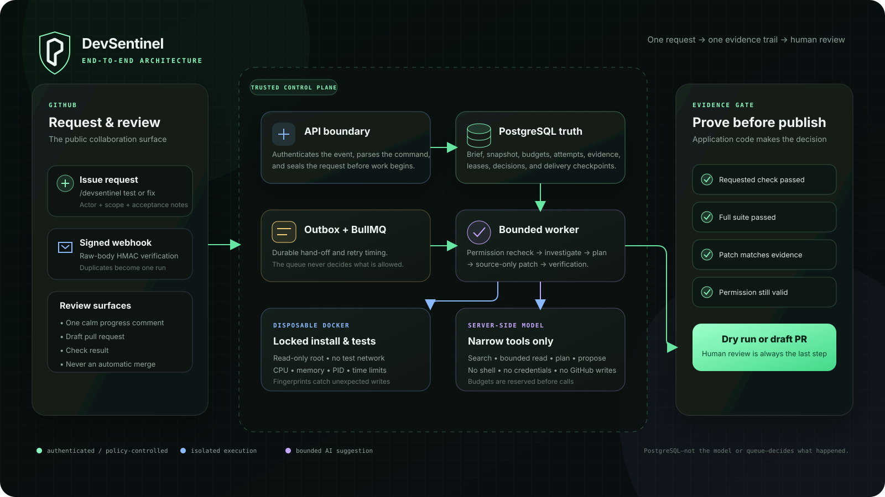

<p align="center">
  <a href="https://github.com/apps/devsentinel-darshpatel1052">
    
  </a>
</p>

<h1 align="center">DevSentinel</h1>

<p align="center"><strong>Issue-scoped repairs with a visible chain of evidence.</strong><br>GitHub-native, review-first, and never an automatic merge.</p>

DevSentinel is a GitHub-native test and issue-repair assistant for a single
operator. It authenticates GitHub webhooks, rechecks the requesting actor's
repository permission, captures an exact commit, runs locked Node.js tests in
disposable Docker containers, and records the resulting evidence in PostgreSQL.

In `FIX` mode one bounded agent can investigate, save a reviewable plan, request
one clarification, propose an issue-scoped patch, and ask for application-owned
verification. It cannot run a host shell, choose arbitrary commands, read
credentials, call GitHub directly, or merge. A delivery-eligible repair needs
recorded execution evidence; an AI statement that the acceptance criteria are
satisfied is never sufficient.

The default configuration performs no model calls and no GitHub writes. This is
a polished, locally runnable Node.js-repository MVP, not a public multi-tenant
service.

## Workflow



A signed issue command becomes one durable run. DevSentinel checks the actor,
captures the exact commit, runs the unchanged project in Docker, and—only in
`FIX` mode—uses a tightly bounded agent to investigate and prepare a source-only
change. The application then runs the requested check and the complete suite,
matches the saved patch to that evidence, rechecks GitHub permission, and either
saves a dry-run report or opens a draft pull request.

If the request is unclear, the behavior cannot be reproduced, a required check
is still red, or a run limit is reached, DevSentinel stops and says what needs
review. It does not quietly widen scope or make unrelated code green.

PostgreSQL is workflow truth. BullMQ supplies retry timing, while Docker owns
disposable execution. Model attempts and conservative model/tool reservations
commit before uncertain external work, so retries, crashes, and clarification
continuations cannot replenish the budget.

## Start locally

Use one reproducible path from the repository root:

```bash
pnpm install
cp .env.example .env                    # first setup only; then edit .env
docker compose up -d --wait postgres redis
pnpm db:migrate
pnpm build
pnpm dev
```

Open `http://127.0.0.1:3001/dashboard`. The protected control API is enabled
only when `CONTROL_API_TOKEN` is at least 32 characters. The dashboard keeps
that token in memory—not in its URL or persistent browser storage—and uses an
authenticated fetch stream with resumable event IDs.

The example environment uses a harmless local fixture,
`development-allow-all`, a disabled model, a deterministic inspector fallback,
and dry-run delivery. See [configuration](docs/configuration.md),
[commands](docs/commands.md), and the [demo](docs/demo.md).

## Verify the release

```bash
pnpm build
pnpm test
pnpm test:evaluation
pnpm test:integration
pnpm test:browser
```

Integration and browser suites create their own PostgreSQL and Redis containers
on random loopback ports. They do not load `.env`, truncate development tables,
or remove development volumes. On Linux hosts where Docker bridge forwarding is
unavailable, prefix the last two commands with
`DEVSENTINEL_TEST_NETWORK=host`; the disposable services still bind to
`127.0.0.1`.

`test:evaluation` is an offline deterministic quality signal. The paid
`test:evaluation:live` command is deliberately opt-in and must not be presented
as having run unless valid provider credentials were intentionally used.

## Agent and verification contract

- A task brief seals the issue, full command, actor/source provenance, requested
  outcome, criteria, constraints, approved/excluded paths, captured SHA, and
  repository-guidance hash.
- Issue discussion, source, logs, repository guidance, and tool results are
  untrusted evidence. They cannot grant permission, expand scope, increase
  budgets, or reveal credentials.
- Investigation tools are phase-limited `list`, literal `search`, bounded text
  `read`, approved test-profile requests, plan submission, one clarification,
  audited regression proposal, and source-patch proposal.
- Application validation enforces paths, file/link type, executable/protected
  file exclusions, edit count/size, secret-like content filtering, tool limits,
  model limits, deadlines, and sandbox resource limits.
- Existing tests cannot be edited. A new reproducer is allowed only when both
  the operator environment and captured `.devsentinel.json` opt in. Its exact
  hash must fail on original source, pass with the source patch, and accompany a
  passing required full suite.
- Any remaining required-check failure blocks delivery. This release has no
  review-only exception that can be mistaken for verified delivery.
- GitHub delivery derives commit author and committer from the configured App,
  never from a repository-specific hardcoded bot.

## Workspace

- `apps/api` — Fastify webhook boundary, authenticated operations API, SSE,
  read-only inspector, and dashboard.
- `apps/dispatcher` — leased PostgreSQL-outbox to BullMQ relay.
- `apps/worker` — authorization, snapshot, baseline, repair, verification, and
  GitHub delivery.
- `packages/domain` — webhook and state-machine contracts.
- `packages/database` — additive migrations and durable evidence/checkpoints.
- `packages/queue` — validated job contracts and retry routing.
- `packages/sandbox` — package detection and hardened local Docker execution.

Further reading: [architecture](docs/architecture.md),
[repair walkthrough](docs/learning/05-repair-and-delivery.md),
[operations and recovery](docs/operations-and-recovery.md),
[threat model](docs/threat-model.md), [release evidence](docs/RELEASE-EVIDENCE.md),
and [go-live checklist](docs/GO-LIVE.md).

The architecture guide includes the complete [repair
journey](docs/assets/repair-journey.svg) and [security and evidence
gates](docs/assets/security-evidence-gates.svg) as original, editable, and
accessible SVG source files.

## Honest boundary

Docker uses a shared host kernel. Dependency installation has registry egress
with lifecycle scripts disabled; tests have no network. Secret detection is
best-effort, and passing tests do not prove semantic correctness. Public
multi-tenant use still needs VM-grade isolation, tenant identity and quotas,
controlled egress, retention/backup policy, and deployment monitoring. Never
expose the dashboard or Docker socket directly to the public internet.
