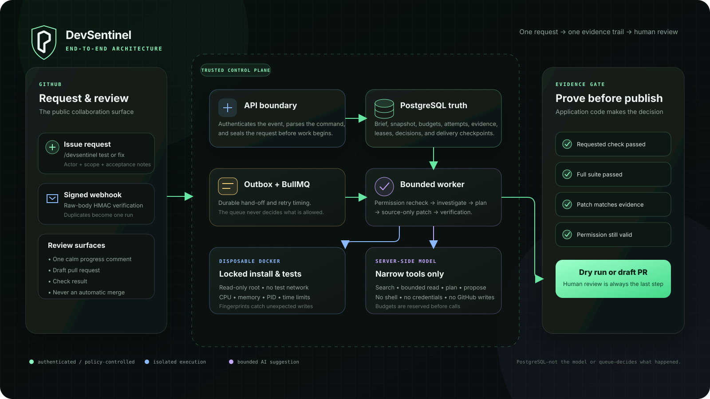
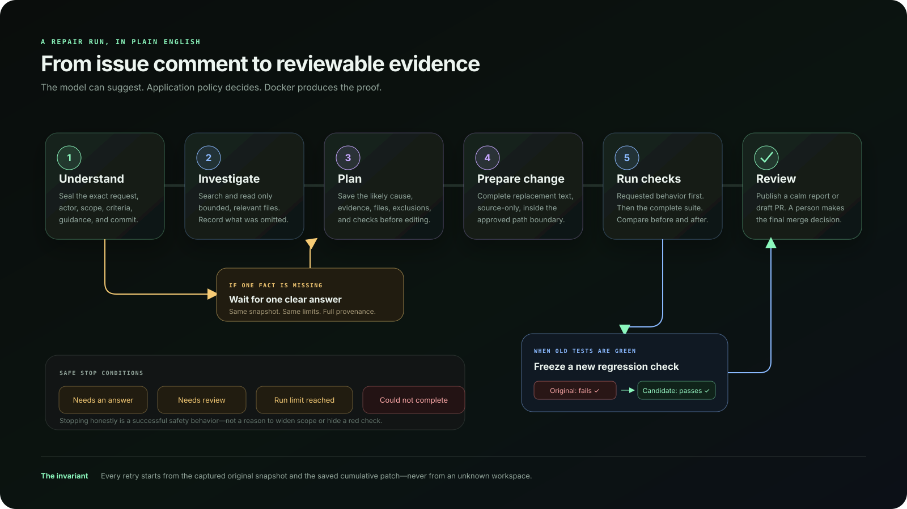
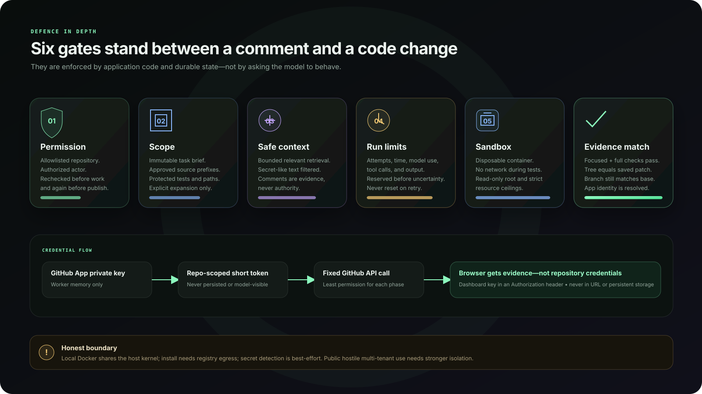

# DevSentinel architecture

This describes the implemented single-operator MVP. Model calls and GitHub
publishing remain explicit opt-ins. PostgreSQL, not Redis or the model, decides
what happened and what may happen next.

## Trust and data flow

Credentials stay inside API/worker adapters. They are never placed in model
input, PostgreSQL, BullMQ jobs, Docker environments, logs, browser URLs, or
persistent browser storage.

## Durable state

The initial webhook transaction stores an idempotent delivery, run, immutable
task brief, and outbox event together. The brief includes source IDs and
timestamps, the complete triggering command, structured outcome/criteria/scope,
and the actor. Snapshot capture seals its commit and the captured repository
guidance/configuration hash.

`run_workflows` owns the fenced lease, deadlines, repair-attempt count,
conservative token reservations, tool-call/output reservations, inspector
budgets, delivery checkpoints, and last recovery error. `repair_attempts` owns
actual/unknown usage, configured-rate cost estimates, sanitized provider
diagnostics, tool traces, proposals, regression evidence, targeted/full-suite
verification, criteria-to-evidence records, unrelated failures, and delivery
eligibility. Plans, clarifications, approvals, selected context, inspector
answers, executions, and events have dedicated records.

Reservations commit before calls whose result could be lost. They are admission
limits, not billed usage, and are not refunded after uncertainty. A worker
redelivery claims the existing workflow and continues from saved state. An
authorized clarification answer requeues the same run with its remaining budget.

## State machine

The database keeps stable machine codes for transitions and queries. The UI and
GitHub reports translate them into normal language: for example,
`NEEDS_HUMAN` appears as **Needs review**, `AWAITING_CLARIFICATION` as **Waiting
for answer**, and `BUDGET_EXHAUSTED` as **Run limit reached**.

Failure classification is separate from status and distinguishes unclear,
unreproduced, baseline, policy, patch, budget, permanent configuration,
transient infrastructure, cancellation, and verified-but-undelivered outcomes.
Exhausted queue work is terminalized with durable evidence rather than left in a
misleading active state.

## Agent boundaries

The one repair agent follows understand → investigate → plan → patch. Global
rules are versioned in the application. `.devsentinel.json` can select bounded
source prefixes, package-test profiles, exclusions, and whether designated
regression-test directories are eligible. `DEVSENTINEL.md` supplies conventions.
Neither file can change host commands, sandbox settings, credentials,
permissions, global rules, or process budgets.

The application exposes only phase-appropriate functions. Paths are normalized
and revalidated; linked, binary, oversized, hidden, executable, generated,
dependency, workflow, and secret-like inputs are excluded. The test request
selects a named application-owned package-test profile—not a shell string.
GitHub writes are not agent tools.

## Verification gate

A candidate is recreated from the captured original snapshot, the saved
cumulative source patch is applied, and a fresh locked install/test executes in
the sandbox. Fingerprints detect mutation outside the authorized patch.
Relevant and full-suite results are recorded independently.

When the unchanged suite does not reproduce the issue, source repair stops
unless the separately gated regression capability is enabled. The application
revalidates and freezes one new test, proves it fails with original source, then
applies the source patch and requires that exact test plus the complete existing
suite to pass. Existing tests remain immutable. Publication re-hashes the test
and refuses any mismatch.

Acceptance records are computed from execution references. “Supported by
execution” means the cited candidate checks ran and passed; it is not an AI
opinion or proof that the criterion is semantically exhaustive. Unrelated or
otherwise required red checks make `deliveryEligible=false`. No review-only
override exists in this release.

## GitHub side effects

Authorization is checked before costly repair and again at publication. The
publisher resolves the configured App and its bot account for commit authorship,
checks the default branch is still the captured base, and matches the saved patch
to the generated tree and single-parent commit. It never force-pushes or writes
the default branch.

The stable `devsentinel/run-<uuid>` branch, run marker, App-owned comments, and
Checks make lost-response retries reconcilable. Progress uses one paginated,
reconciled comment per run. Final success is recorded only after external
artifacts were observed or recreated safely.

GitHub is a reviewer surface, not an admin console. Its progress comment, draft
PR body, Check, and final issue comment show the request, approved files,
proposed change, checks, acceptance evidence, blockers, and next step. Model
allowances, tool counts, attempt accounting, and cost estimates stay in the
authenticated dashboard/operator record.

## Local sandbox and production gap

The local provider runs install and tests as a non-root numeric user with a
read-only root filesystem, dropped capabilities, `no-new-privileges`, default
seccomp, CPU/memory/PID/open-file/output/time limits, and cleanup in `finally`.
Tests use Docker `none` networking. Install uses registry networking with
lifecycle scripts disabled.

This is good local/CI containment, not hostile multi-tenant isolation: Docker
shares the host kernel and the worker controls the daemon. Public service work
requires dedicated nodes and VM-grade isolation, digest/egress policy,
per-tenant quotas, retention/backups, and production telemetry.

## Reliability invariants

1. A GitHub delivery produces at most one receipt and one run.
2. Run creation and its first outbox event commit together.
3. Forged webhooks produce no workflow write.
4. Queue redelivery never resets budgets or changes the captured SHA.
5. Stale lease owners cannot checkpoint or publish.
6. Cancellation and current permission are rechecked at side-effect boundaries.
7. Repository/model content cannot select host commands or expand authority.
8. A source patch is delivered only when it exactly matches stored evidence.
9. Required red checks block verified delivery.
10. Integration tests use disposable services and cannot default to developer
    workflow tables.

The rationale for the full contract is in
[ADR 0004](adr/0004-evidence-gated-agent-contract.md).
